# CinéAtlas USMBA — Mini-projet Thymeleaf (sujet n° 13 : Cinéma)

Application web de gestion d'une programmation cinématographique, réalisée avec **Spring Boot 3.3.5**,
**Thymeleaf**, **Spring Data JPA** et **MariaDB**. Elle couvre les trois entités demandées par le
sujet — `Film`, `Seance`, `Billet` — avec leurs relations `@ManyToOne`, les opérations CRUD complètes,
les filtres et les statistiques d'exploitation.

Le projet est volontairement autonome : identité visuelle propre (thème sombre « salle obscure »),
URL et libellés entièrement en français, couche service séparée de la couche web, et plusieurs règles
métier ajoutées au-delà de l'énoncé.

---

## Ce que fait l'application

**Gérer l'affiche (films)**

- Catalogue avec filtrage par genre et recherche par titre.
- Création / modification / suppression d'un film (titre, genre, durée en minutes, réalisateur, année).
- Refus des doublons de titre (comparaison insensible à la casse) et interdiction de supprimer un film
  qui possède encore des séances programmées.

**Planifier les séances**

- Création / modification / suppression d'une séance (date et heure, salle, version VF / VOSTFR / VO,
  capacité de la salle, film).
- Filtrage du planning par salle, par date et par film.
- Trois garde-fous implémentés dans `SeanceService` : pas de séance dans le passé, pas de chevauchement
  dans une même salle, capacité jamais inférieure au nombre de billets déjà vendus.

**Vendre et annuler les billets**

- Registre des billets avec filtrage par statut (`VALIDE`, `UTILISE`, `ANNULE`) et recherche par nom
  d'acheteur ou par téléphone.
- Émission d'un billet avec contrôle du tarif (10 à 500 MAD) et du format du téléphone marocain.
- Annulation (la place est remise en vente), validation à l'entrée (passage en `UTILISE`), suppression.
- Une séance complète refuse toute nouvelle vente ; un billet déjà utilisé ne peut plus être annulé.

**Statistiques**

- Taux de remplissage par séance (billets non annulés / capacité) sous forme de jauges.
- Recettes par film, évolution des ventes par mois, répartition du catalogue par genre.

---

## Données de démonstration

Au premier démarrage, si la table `films` est vide, `JeuDeDonnees` insère un jeu cohérent :

- **6 films** : *Les Lanternes du Draa*, *MEDINA 2049*, *Le Cèdre bleu*, *Atelier 7 : la dernière coupe*,
  *Résine et Safran*, *La craie du tableau noir* — un par genre, avec réalisateurs et durées réalistes.
- **8 séances** réparties sur trois salles (SALLE ATLAS, SALLE OUARZAZATE, SALLE TETOUAN),
  capacités de 20 à 40 places.
- **101 billets** dont environ 10 % annulés et 10 % déjà utilisés, avec des noms et des numéros de
  téléphone marocains valides. Le taux de remplissage s'étale de 23 % à 100 %, ce qui rend les
  statistiques lisibles.

---

## Prérequis

| Outil | Version utilisée |
|---|---|
| JDK | 21 |
| Maven | 3.9 |
| MariaDB / MySQL | 10.4 (XAMPP) |

La base `cine_atlas` est créée automatiquement (`createDatabaseIfNotExist=true`). Le compte par défaut
est `root` sans mot de passe — à adapter dans `src/main/resources/application.properties`.

```bash
mvn clean package
java -jar target/cine-atlas.jar
```

L'application écoute sur <http://localhost:8080>.

---

## Résultats obtenus

### Tableau de bord

Vue d'accueil qui synthétise l'activité : nombre de films au catalogue, séances programmées, billets
vendus, recette nette, et les prochaines séances avec leur taux de remplissage.

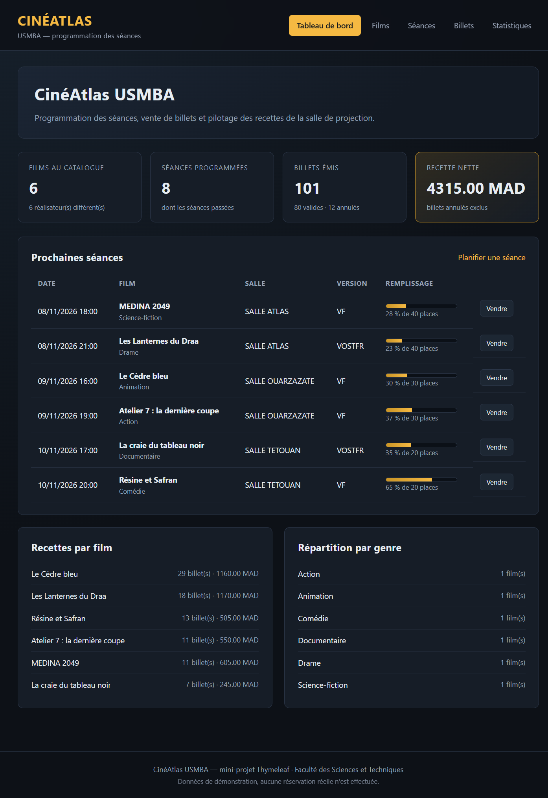

### Catalogue des films

La liste complète des films avec genre, durée formatée (`2h12`), réalisateur, année et nombre de
séances rattachées. Chaque ligne propose *Modifier* et *Supprimer*.

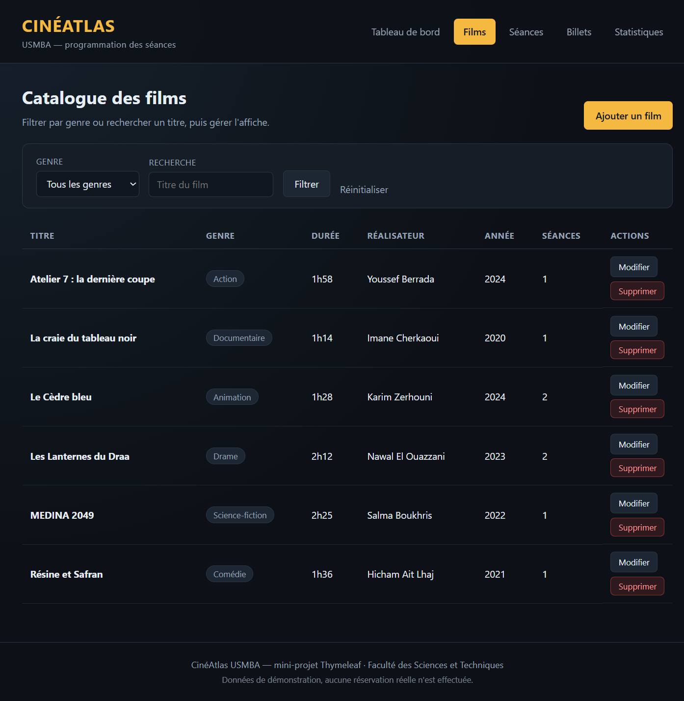

### Filtrage par genre

Le même écran filtré sur le genre *Drame* : un seul film remonte. Le filtre par genre et la recherche
par titre sont cumulables.

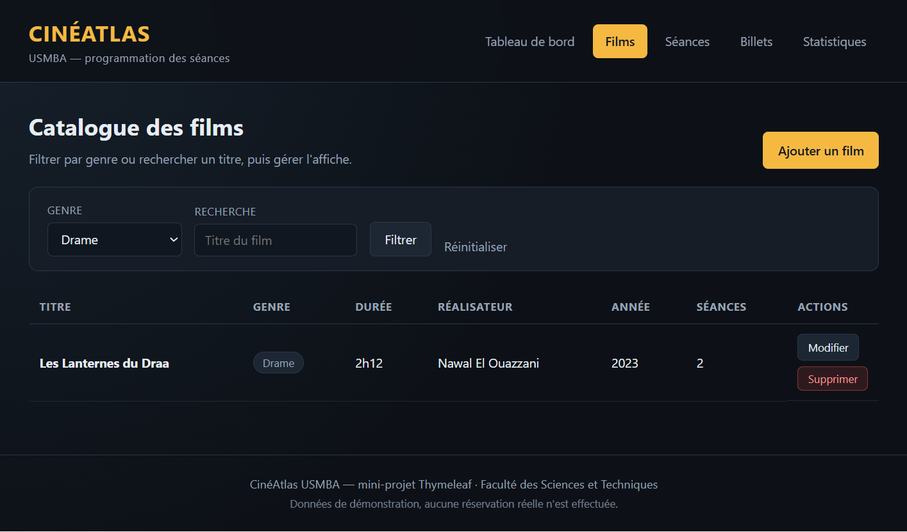

### Formulaire d'ajout d'un film

Formulaire Thymeleaf relié à l'entité `Film` par `th:object`. Les listes déroulantes (genre, version)
sont alimentées par les énumérations exposées via `@ModelAttribute`.


### Erreurs de validation côté serveur

Soumission du formulaire vide : les cinq contraintes Bean Validation s'affichent une par une sous les
champs concernés. Les messages sont en français et correctement accentués.

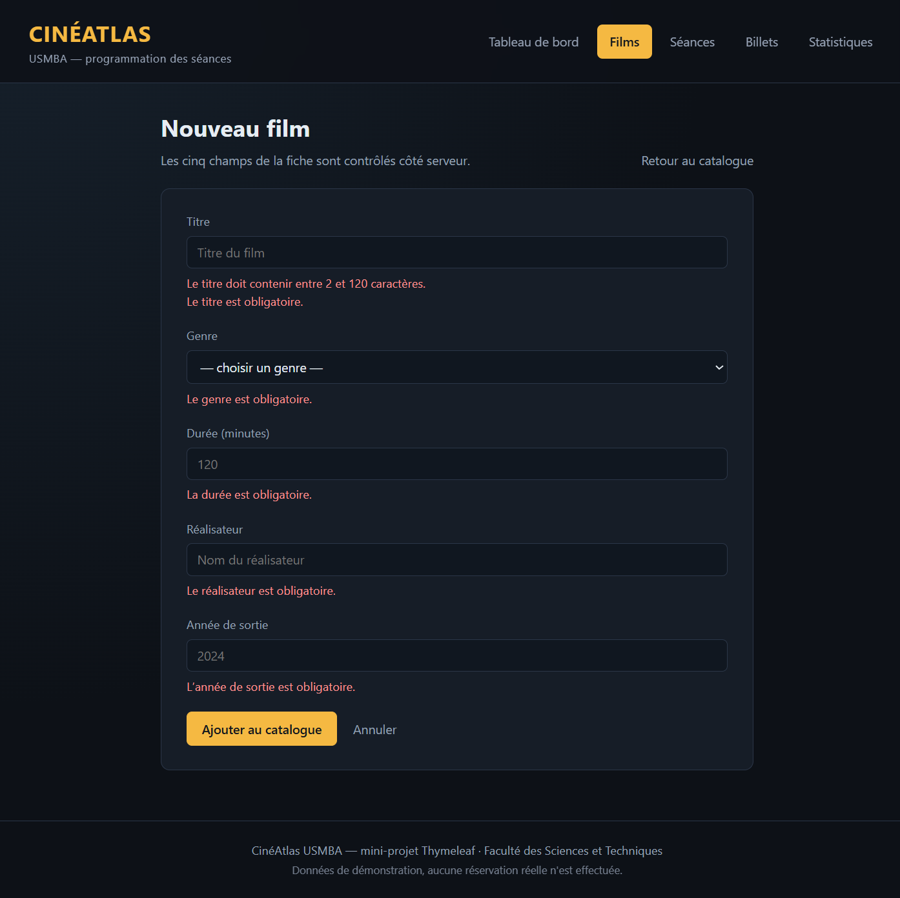

### Planning des séances

Chaque séance affiche sa date et son heure formatées (`dd/MM/yyyy`, `HH:mm`), son film, sa salle, sa
version, une jauge de remplissage et le ratio *places vendues / capacité*. Les actions *Vendre*,
*Modifier* et *Supprimer* sont accessibles directement depuis la ligne.

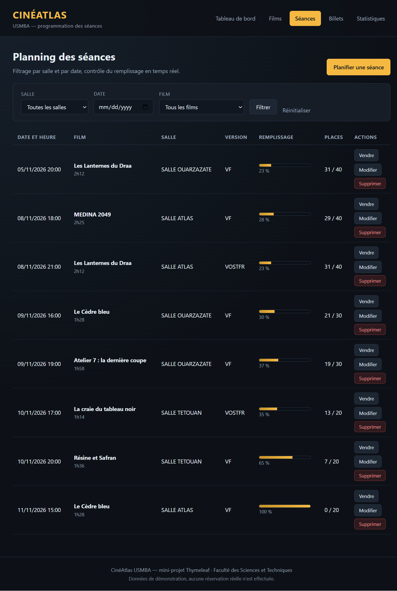

### Filtrage du planning par salle

Le planning restreint à la SALLE OUARZAZATE. Le filtre accepte également une date et un film.

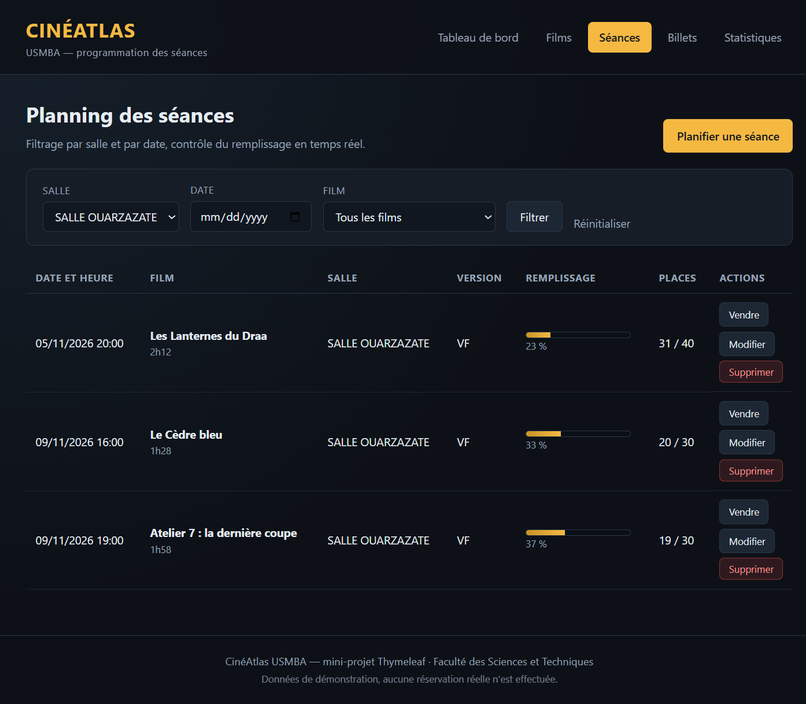

### Formulaire de planification d'une séance

Le choix du film se fait dans une liste déroulante reliée par un `Converter<String, Film>` : Spring
convertit l'identifiant transmis en véritable entité `Film`.

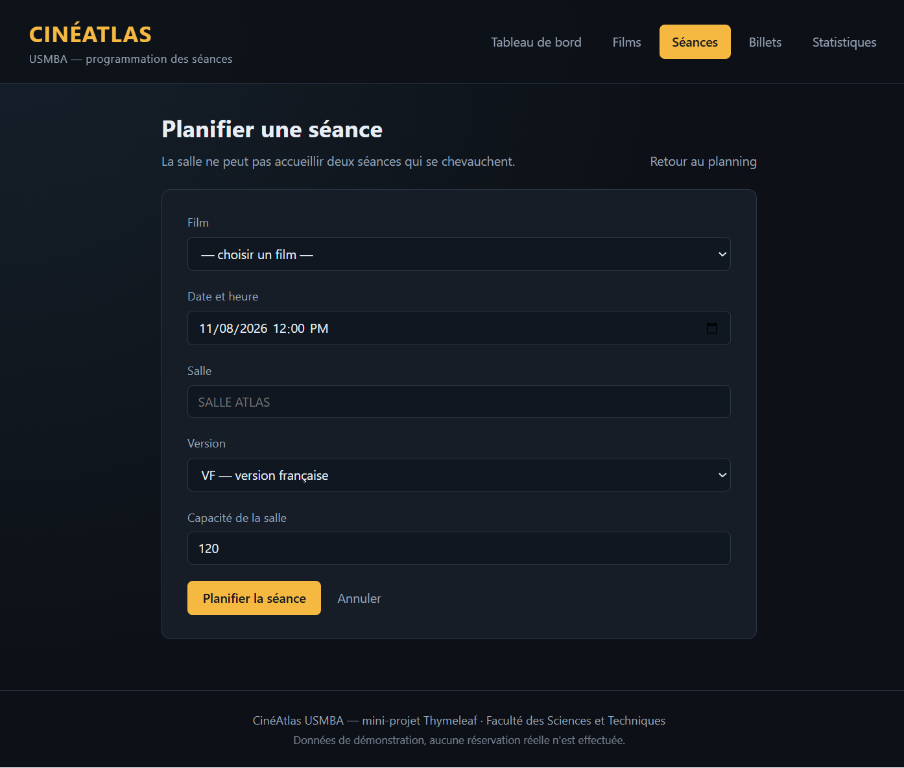

### Contrôle de chevauchement de salle

Tentative de programmer une séance à 19 h 30 dans la SALLE ATLAS alors qu'une autre séance y occupe
déjà le créneau 18 h 00 – 20 h 45. Le service calcule l'intervalle réel (heure de début + durée du
film) et refuse l'enregistrement en expliquant le conflit.

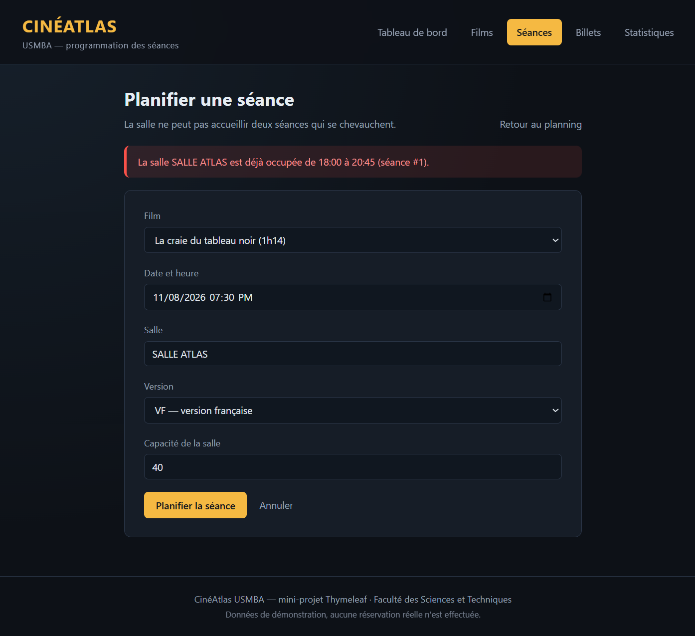

### Registre des billets

Le registre complet : acheteur, téléphone, séance concernée, prix, date d'achat et statut coloré. Les
actions *Valider*, *Annuler* et *Supprimer* sont proposées selon l'état du billet.

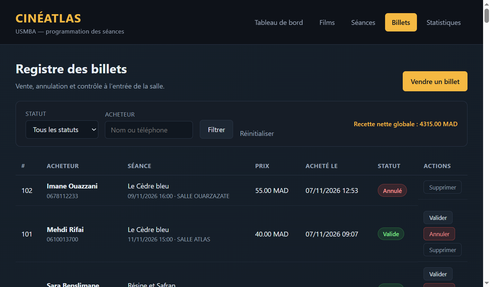

### Vente d'un billet

Formulaire d'émission, avec la séance présélectionnée depuis le bouton *Vendre* du planning.

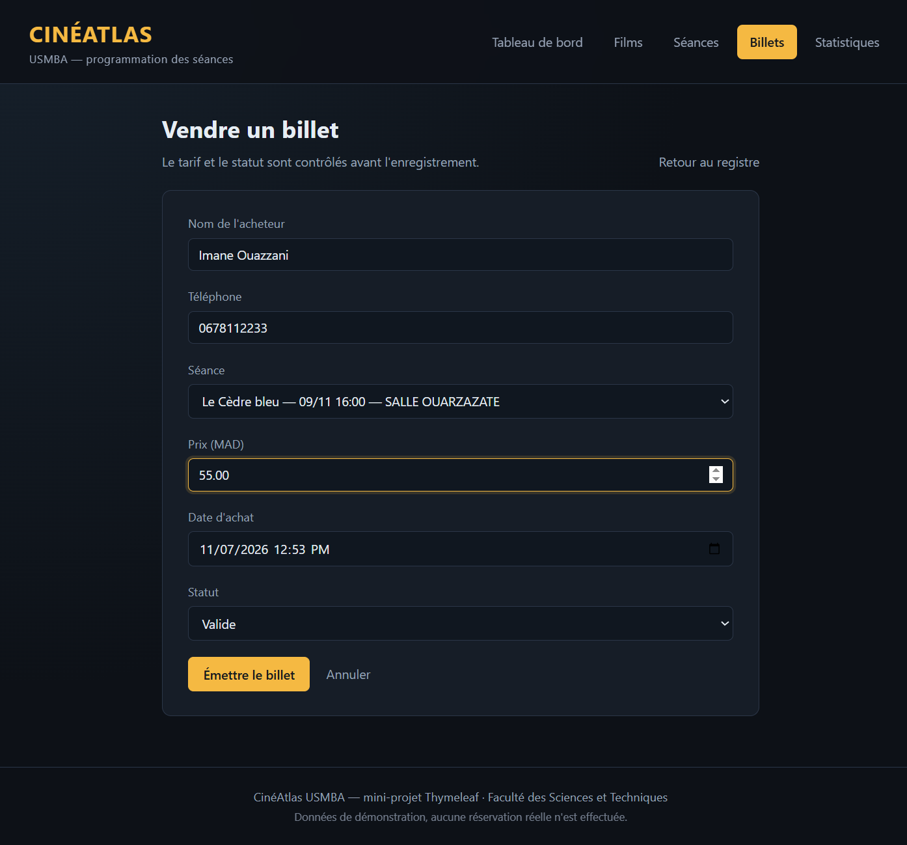

### Confirmation de vente

Après validation, le message de confirmation nomme l'acheteur et le film, et le billet apparaît en
tête du registre.

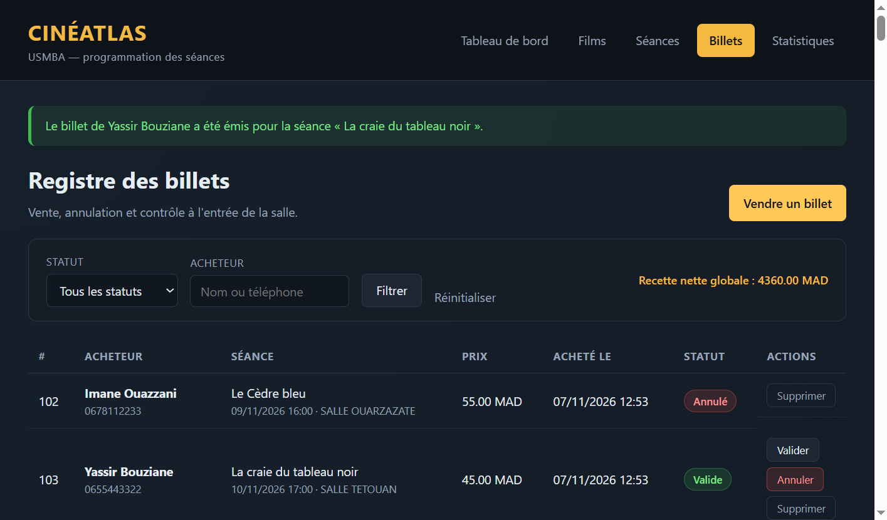

### Annulation d'un billet

L'annulation passe par une boîte de confirmation native (attribut `data-confirmation` + `window.confirm`).
Le message final indique que la place est remise en vente.

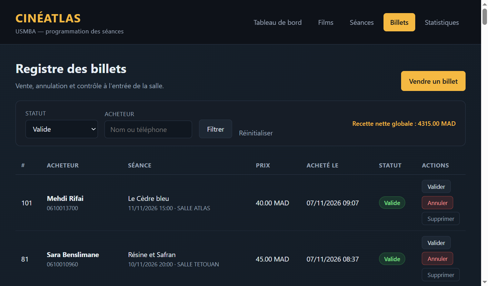

### Statistiques d'exploitation

Trois blocs : taux de remplissage par séance avec jauges, classement des recettes par film, et
évolution mensuelle des ventes (libellé français « Novembre 2026 »).

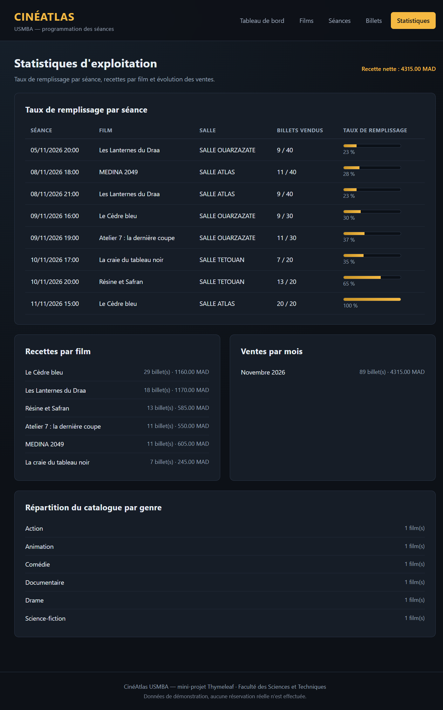

---

## Choix d'implémentation

- **Couche service systématique** : le contrôleur ne fait que du binding et de la redirection ; toutes
  les règles métier vivent dans `FilmService`, `SeanceService` et `BilletService`, qui lèvent une
  `ExceptionMetier` transformée en message flash.
- **Aucun Bootstrap** : `cine-atlas.css` définit l'identité visuelle complète (palette sombre, halos
  ambres, jauges en dégradé) pour éviter la ressemblance avec les rendus génériques.
- **`open-in-view=false`** : les associations `@ManyToOne` sont en `FetchType.EAGER` et les compteurs
  proviennent de requêtes de dépôt, ce qui supprime tout risque de `LazyInitializationException`.
- **Requêtes d'agrégation** : `BilletDepot` contient les `@Query` de statistiques
  (`recettesParFilm`, `ventesParMois` avec `date_format`, `chiffreAffairesTotal`).
- **Messages d'erreur en français** avec apostrophes typographiques (`’`) — indispensable car
  `MessageFormat` consomme l'apostrophe droite et afficherait `Lannée` au lieu de `L'année`.
- **Confirmation de suppression** sans JavaScript inline : un écouteur unique sur
  `form[data-confirmation]` (Thymeleaf 3.1 interdit les expressions dans les attributs d'événement).

## Personnalisation par rapport à l'énoncé

- Le domaine est transposé dans un contexte marocain : salles ATLAS / OUARZAZATE / TETOUAN, films aux
  titres originaux, noms d'acheteurs et numéros de téléphone locaux.
- Le sujet demande un CRUD ; j'ai ajouté **cinq règles métier** non demandées : anti-chevauchement de
  salle, refus des séances passées, capacité minimale liée aux ventes, interdiction d'annuler un billet
  déjà utilisé, et refus de vente sur une séance complète.
- Le sujet demande deux statistiques ; la page en propose **cinq** (remplissage, recettes par film,
  ventes par mois, répartition par genre, recette nette globale).
- Le code est en français (package `ma.usmba.cinema`, classes `FilmDepot`, `SeanceService`,
  `ProgrammationControleur`…) plutôt qu'en anglais générique.

## Structure du projet

```
src/main/java/ma/usmba/cinema/
├── CineAtlasApplication.java
├── modele/          Film, Seance, Billet, GenreFilm, StatutBillet
├── depot/           FilmDepot, SeanceDepot, BilletDepot
├── service/         FilmService, SeanceService, BilletService, ExceptionMetier
├── controleur/      ProgrammationControleur
└── configuration/   JeuDeDonnees, ConvertisseurFilm, ConvertisseurSeance

src/main/resources/
├── application.properties
├── templates/       9 gabarits Thymeleaf (fragments partagés inclus)
└── static/          css/cine-atlas.css, js/cine-atlas.js
```
